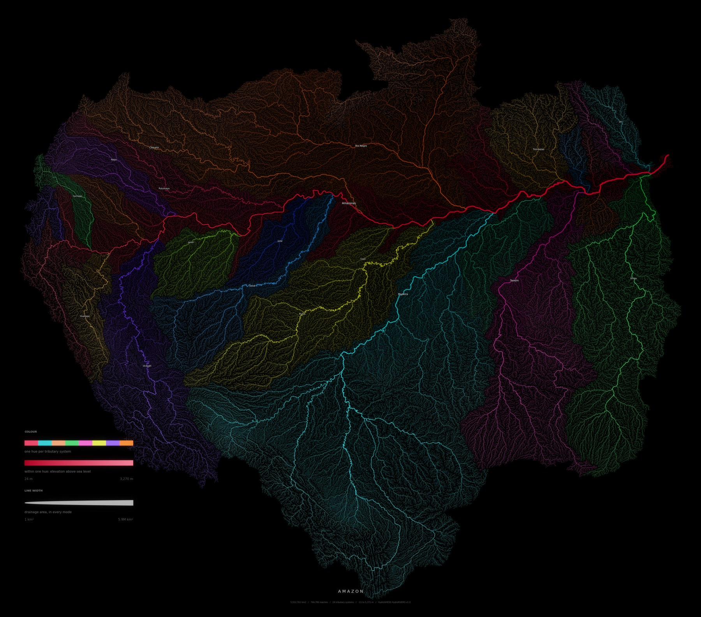
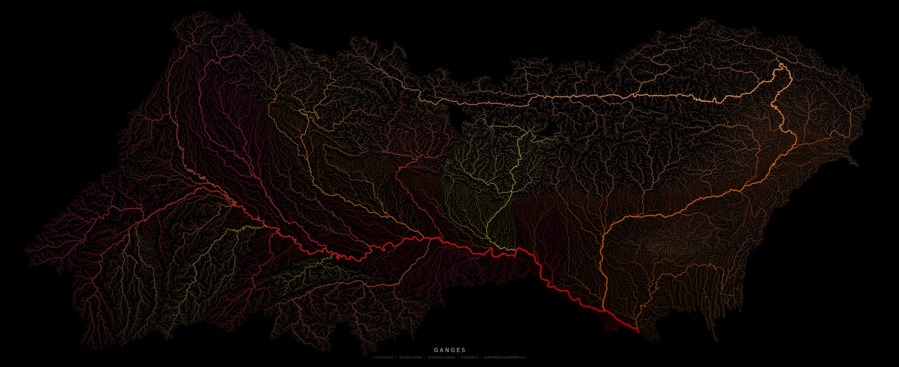
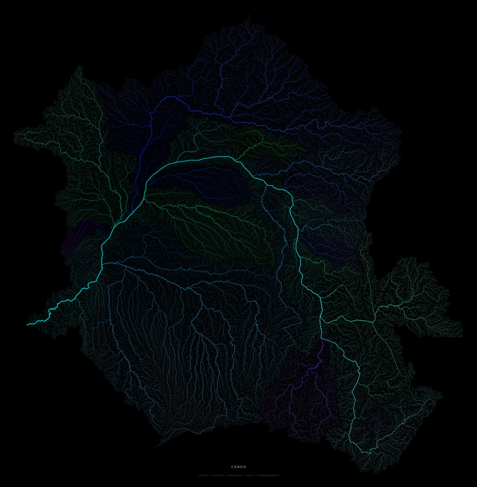
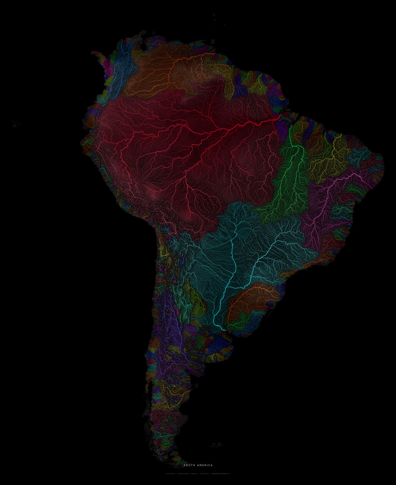
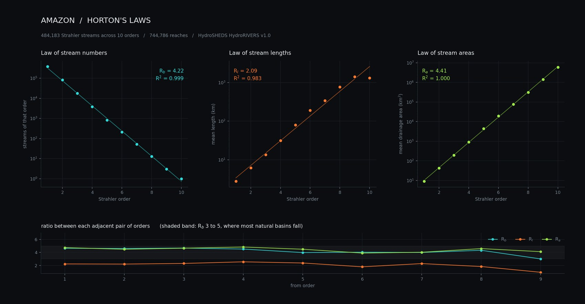
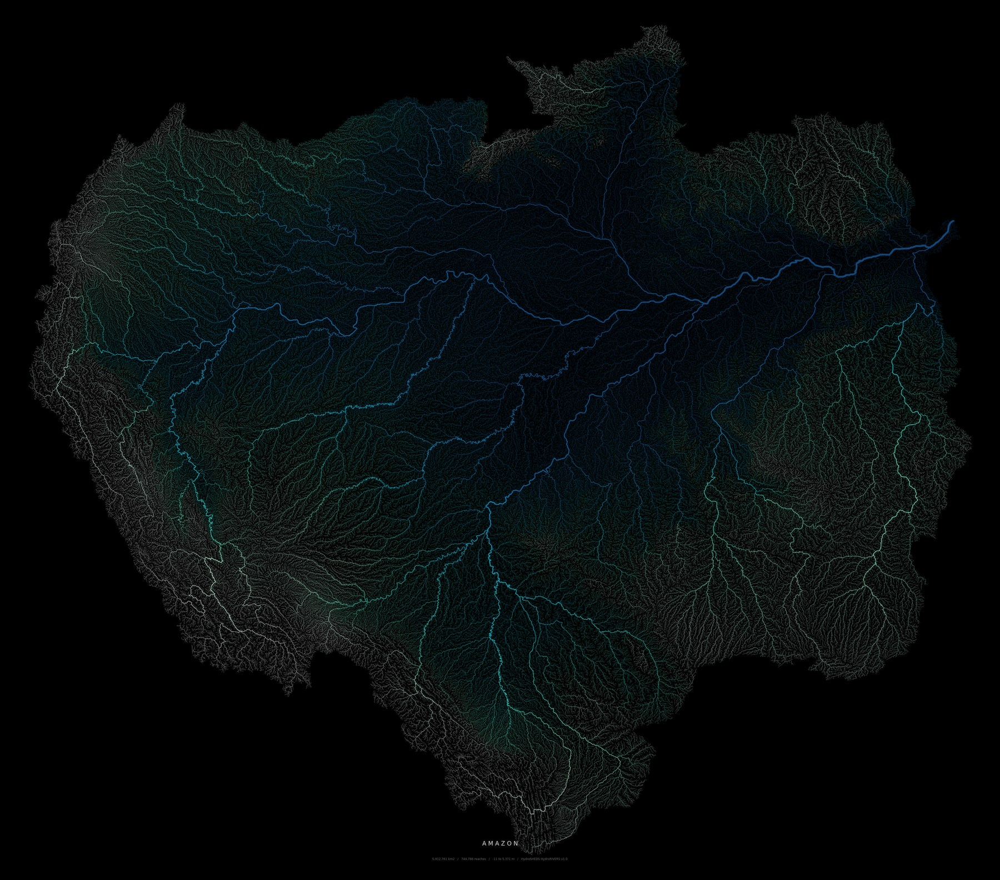
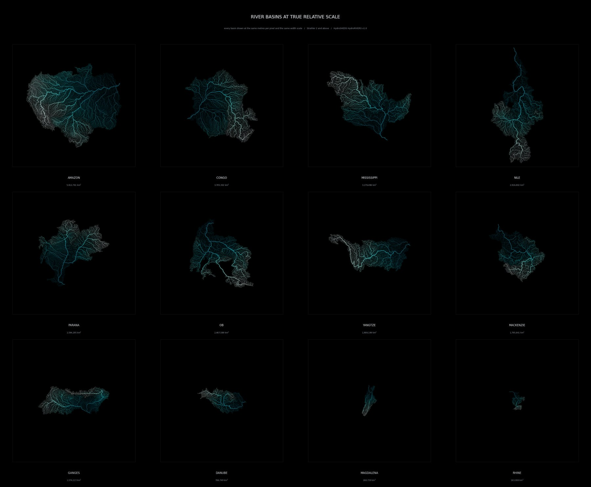

# River Basin Dendrograms

Renders a single river basin from [HydroSHEDS / HydroRIVERS](https://www.hydrosheds.org/)
as a tapered dendrogram on black: every stream drawn as a line that thickens from
headwater to outlet, coloured either by the elevation it runs through or by which
tributary system it belongs to.

At basin scale a drainage network stops looking like a map and starts looking like
a nervous system. The Amazon carries 744,786 individual reaches.



<p align="center"><em>Amazon, 5,912,761 km&sup2;, 744,786 reaches, 24 tributary
systems, 18 of them named automatically against Natural Earth</em></p>



<p align="center"><em>Ganges and Brahmaputra, 1,574,223 km&sup2;, coral hues</em></p>



<p align="center"><em>Congo, 3,705,302 km&sup2;, reef hues</em></p>

It also runs on a whole continent rather than one basin, colouring by basin
instead of by tributary. Nothing here is a coastline: the outline is simply
where the rivers stop.



<p align="center"><em>South America, 15,511 basins, 1,620,963 reaches,
5,976,136 tapered segments</em></p>

The network is also measurable, not only drawable. Horton's laws hold across
all ten of the Amazon's Strahler orders, with a bifurcation ratio of 4.22 at an
R<sup>2</sup> of 0.999:



The same basin coloured by elevation instead, which is the other half of what
this does:



<p align="center"><em>Amazon, abyss palette, colour by elevation</em></p>

## Install

```bash
pip install -r requirements.txt
```

## Use

```bash
python render.py amazon
```

That is the whole first run. It downloads the South America river network
(95 MB) and the matching 30 arc-second elevation model (32 MB), finds the
Amazon, and writes a 4000 px PNG to `out/`.

More:

```bash
python render.py amazon --color basin                  # a hue per tributary
python render.py ganges --color basin --hues coral --tributaries 20
python render.py amazon --color basin --shade 0        # flat poster colour
python render.py ganges --palette ember --width 6000 --title
python render.py congo --palette verdant --color discharge
python render.py --at -63.55,8.13 --region sa --name Orinoco
python render.py --list-basins af
python gallery.py
```

A whole continent at once, every basin its own colour, rather than one basin:

```bash
python render.py --all-basins sa --color basin --tributaries 40
```

Output sized for printing rather than for a screen:

```bash
python render.py amazon --color basin --paper a2 --dpi 300
```

`--paper` turns the sheet to suit the basin, fits the network inside it without
cropping or distortion, and writes the dpi into the PNG so a print shop reads
the physical size straight off the file.

Downloads and basin extracts are cached under `data/`, so the first render of a
basin takes about two minutes and every later one takes seconds.

## Reading a plate

Three variables ride on every image at once, and the most common wrong guess is
that colour and thickness say the same thing. They never do.

```bash
python render.py amazon --color basin --legend
```

| channel | means |
| --- | --- |
| line thickness | drainage area, in every mode, always |
| hue | which tributary system, or which basin in `--all-basins` |
| brightness within a hue | the shading variable, elevation by default |

In the elevation modes there are no hues at all: colour is a single ramp and
nothing else. `--legend` draws a key saying which of those is in force, with
the real value range on it, so a plate explains itself once it leaves the
repository.

The key is an encoding key rather than a list of categories. There can be 24
hues on a basin plate and 15,511 on a continental one, so enumerating them
would just be a second map.

## Naming the tributaries

HydroRIVERS carries no names at all. A reach knows its id, its neighbour and
its drainage area, and nothing else, so the plates come out with 24 hues and no
way to tell which one is the Madeira.

```bash
python render.py amazon --color basin --label-rivers
```

Natural Earth publishes named river centrelines, about 1,400 worldwide in a
2 MB download. They are a generalised cartographic layer drawn at a far coarser
scale than HydroRIVERS, so the two do not line up. They do not need to. Walk
each tributary group's trunk, sample points down it, ask which named line is
nearest to each, and let them vote. Following the trunk rather than the whole
group matters: a vote over every reach in a group drags in sub tributaries that
carry their own names.

On the Amazon that names 18 of 25 groups, and gets all 18 right: Amazonas,
Madeira, Rio Negro, Xingu, Tapajos, Purus, Ucayali, Caqueta, Jurua, Trombetas,
Putumayo, Javari, Napo, Huallaga, Jutai, Jari, Santiago, Coari. A group is left
unnamed unless one name takes at least a quarter of the sampled points, which
is what stops a tributary with no Natural Earth counterpart from stealing its
neighbour's name.

Labels are placed largest river first and measured in display space, and any
that would collide is dropped rather than nudged. On a network this dense, a
label moved far enough to fit is a label pointing at the wrong river.

One gotcha worth recording: the Natural Earth shapefile is latin-1 and ships no
`.cpg` to say so, so without an explicit encoding every accented name comes back
as mojibake. There is a test pinning that.

## Horton's laws

```bash
python analyse.py amazon
```

Horton observed in 1945 that a drainage network is close to self similar.
Stream counts fall off geometrically with Strahler order while mean lengths and
mean drainage areas grow geometrically, and the ratios between successive
orders stay roughly constant. That constancy is the reason a basin looks like a
nervous system at every zoom level, so it is worth measuring rather than only
drawing.

The Amazon, across all ten of its orders:

| ratio | value | R<sup>2</sup> |
| --- | --- | --- |
| bifurcation R<sub>b</sub> | 4.22 | 0.999 |
| length R<sub>l</sub> | 2.09 | 0.983 |
| area R<sub>a</sub> | 4.41 | 1.000 |

R<sub>b</sub> between 3 and 5 is what almost every natural basin gives, and an
R<sup>2</sup> of 0.999 across four orders of magnitude of stream count is the
law holding about as precisely as field data ever does.

One subtlety drives that whole module. A Strahler *stream* is a maximal chain
of reaches sharing an order, not a single reach, and HydroRIVERS stores short
segments, so one order 4 stream may be fifty consecutive order 4 rows. Counting
rows instead of streams inflates every count by roughly the same factor and
quietly destroys the ratios. It is the easy way to get this wrong, and there is
a test for it.

## Comparing basins

```bash
python compare.py
```

Rendered one at a time, every basin fills its own frame and they all look about
equally impressive, which is exactly the comparison a reader makes by accident.
This draws them at one shared scale: the same metres per pixel and the same
width scale, so the Amazon really is that much larger than the Rhine.

Each basin keeps its own Lambert azimuthal equal-area projection centred on
itself. Every one of those is equal-area, so sharing a scale across them is
fair, where a single projection spanning the globe would not be.



The shared width scale is what makes the sheet honest, and it is also what
makes the smallest basins nearly invisible, so `--lw-gain` thickens every
stroke on the sheet together rather than per basin. `--min-strahler` defaults
to 2 here: first order creeks are sub-pixel in a grid cell anyway, and it is
applied to every basin equally, so the comparison stays fair.

## How it works

**Finding a basin.** Every reach in HydroRIVERS carries `MAIN_RIV`, the id of
the most downstream reach of its network, so one attribute filter pulls out a
complete, topologically closed basin. Those ids are version specific, so the
presets store a seed point on the trunk river instead: the renderer reads the
reaches in a small box around the seed, takes the one draining the largest
area, and uses its `MAIN_RIV`. A slightly wrong coordinate still lands in the
right basin.

**The taper.** `UPLAND_SKM` is the area draining through a reach's downstream
end, so its upstream end carries that minus the reach's own catchment.
Interpolating between the two across the reach's vertices makes every reach
thicken along its length, and keeps widths continuous through junctions, which
is what produces the branching taper rather than a set of abruptly stepped
lines. This only works because HydroRIVERS digitises each reach in the
direction of flow, which is verifiable: the last vertex of a reach coincides
exactly with the first vertex of its `NEXT_DOWN` neighbour.

Width itself follows hydraulic geometry, not a log scale. Channel width grows
roughly with the square root of discharge, and discharge roughly with drainage
area, so width goes as a power of area. The true exponent near 0.5 is too
extreme to draw, so `--width-exp` is a tunable stand in and defaults to 0.40.
This matters more than it sounds: under a normalised log scale a mid order
tributary claims about 70 percent of the width budget, every river in the
basin comes out roughly the same thickness, and the mainstem disappears into
its own tributaries.

**Colour by tributary.** `--color basin` gives each major tributary system its
own hue. This is the single biggest change to how the picture reads: under
elevation colouring every lowland reach of the Amazon lands in the same narrow
band and the interior is one blue haze, whereas by tributary the Madeira, the
Negro and the Xingu separate into territories and the basin becomes a set of
competing systems.

It runs off `NEXT_DOWN`, which makes the reach table a tree rooted at the
outlet. Walk up from the outlet always taking the largest feeder and you have
the mainstem; every reach that pours into it without being part of it starts a
tributary subtree; keep the biggest few and propagate their labels upstream.
That last step needs a topological order, and `DIST_DN_KM` supplies one for
free, because distance to the outlet strictly decreases downstream. So one
sorted pass labels the whole basin, no recursion, about three seconds for the
Amazon's 744,786 reaches.

Hue alone would throw away relief, so the shading term rides inside each hue as
value and saturation. That needs a limit, hence `--shade`. The shading term is
absolute elevation, but a tributary can sit entirely in the lowlands: the Negro
never climbs, so at full strength every reach it owns lands at the bottom of the
value ramp and the whole system turns muddy brown whatever its hue. `--shade 0`
gives flat poster colour, `1` the full ramp, and the default 0.55 keeps each
river's identity legible while still showing which ones rise into the Andes.

**A whole region.** `--all-basins sa` drops the `MAIN_RIV` filter and reads the
entire continental file, then colours by basin rather than by tributary, which
needs no tree walk at all because `MAIN_RIV` already is the basin id. South
America holds 15,511 separate basins across 1.6 million reaches, and the largest
40 account for 80 percent of the drained area, so those take the front of the
palette in order of size and the rest keep cycling through it. That is what
gives the coast its fringe of small independent systems rather than one flat
mass. Stroke width stays normalised against the Amazon, so the continent keeps
its true hierarchy instead of every basin being drawn as though it were the
biggest thing on the page.

**The colour.** Elevation is sampled from the HydroSHEDS 30 arc-second DEM at
every vertex, by reading one window into memory and indexing it with numpy
rather than walking points through rasterio.

Colour then goes through a rank stretch by default, which replaces each value
with its own percentile. A linear elevation ramp is useless on a basin like
the Amazon, where nearly every reach sits below 200 m and a thin Andean rim
holds the top of the range: the entire lowland collapses to one flat colour.
The rank stretch spends the whole ramp on the range that actually contains
data and recovers the downstream gradient. Use `--stretch linear` when the
colours need to mean absolute height.

The ramps themselves never bottom out near black. Elevation and width are
correlated, so the trunk river is both the thickest line and the lowest value,
and a ramp that fades to black erases it exactly where the picture wants its
most weight.

**The glow.** Sub-pixel antialiased hairlines land in the darkest few percent
of the range, so the render finishes with a real bloom pass: threshold the
bright pixels, blur them, screen the result back over the image. The blur is
three octaves rather than one, because a single gaussian gives every stroke the
same halo; stacking a tight, a medium and a wide pass puts a crisp edge on the
trunk and a broad haze over dense headwater country, which is what actually
reads as glow. `--bloom 0` turns it off. A mild `--vignette` finishes the frame.

**Projection.** Lambert azimuthal equal-area centred on the basin, so tributary
geometry stays honest at any latitude instead of being stretched by plate
carree. `--projection aea` or `none` if you want something else.

## Options

| Flag | Default | What it does |
| --- | --- | --- |
| `--all-basins` | off | render an entire region, colouring by basin instead of by tributary |
| `--paper` | off | exact print size: `a5`..`a0`, `letter`, `legal`, `tabloid`, `square30/50/70` |
| `--dpi` | `300` | dots per inch, used with `--paper` |
| `--color` | `elevation` | `basin` for a hue per tributary, or `elevation`, `strahler`, `discharge`, `distance` |
| `--palette` | `abyss` | `abyss` `aurora` `bone` `copper` `cyan` `ember` `ice` `sanguine` `verdant`, or any matplotlib colormap |
| `--hues` | `prism` | hue set for `--color basin`: `prism` `coral` `reef` `faded` |
| `--tributaries` | `24` | how many systems get their own hue |
| `--shade` | `0.55` | relief mixed into each hue; `0` is flat poster colour |
| `--shade-by` | `elevation` | what varies lightness inside a hue |
| `--stretch` | `rank` | `rank` equalises the histogram, `linear` keeps absolute values |
| `--width` | `4000` | output width in pixels; stroke widths scale with it |
| `--lw-min` / `--lw-max` | `0.25` / `7.0` | headwater and outlet stroke width, in pixels at 4000 px |
| `--width-exp` | `0.40` | raise it to thin the tributaries and let the trunk dominate |
| `--bloom` | `0.55` | glow strength, `0` disables the pass |
| `--vignette` | `0.18` | corner darkening, `0` disables it |
| `--label-rivers` | off | name the tributaries from Natural Earth (needs `--color basin`) |
| `--label-size` | `11` | river label size in points at 4000px |
| `--clip` | `2,98` | percentile window for the colour ramp |
| `--projection` | `laea` | `laea`, `aea` or `none` |
| `--min-strahler` | `0` | drop small streams, for lighter renders |
| `--simplify` | `0` | Douglas-Peucker tolerance in degrees, for fast drafts |
| `--invert-ramp` | off | flip the ramp so headwaters take the dark end |
| `--title` | off | draw the caption |
| `--legend` | off | draw a key for colour and line width |

## Basins

Presets, all resolved from a seed point at run time:

| Region | Basins |
| --- | --- |
| South America (`sa`) | `amazon` `parana` `orinoco` `tocantins` `sao-francisco` `magdalena` |
| Asia (`as`) | `ganges` `brahmaputra` `mekong` `yangtze` `yellow-river` `indus` `irrawaddy` |
| Africa (`af`) | `congo` `nile` `niger` `zambezi` |
| North America (`na`) | `mississippi` `columbia` |
| North American Arctic (`ar`) | `mackenzie` `yukon` |
| Europe (`eu`) | `danube` `volga` `rhine` |
| Siberia (`si`) | `ob` `yenisei` `lena` |
| Australia (`au`) | `murray-darling` |

Every preset has been checked against published drainage areas. Twenty two of
the twenty eight land within 5 percent, and the rest are explained below.

Anything else works through `--at LON,LAT --region XX`. `--list-basins XX`
ranks every basin in a region by drainage area if you want to go hunting.

Where the numbers disagree with an atlas, the model is usually the reason
rather than a bad seed:

- `ganges` and `brahmaputra` return the same network, 1,574,223 km&sup2;.
  HydroRIVERS resolves the Ganges, Brahmaputra and Meghna as one system,
  because they meet before reaching the sea.
- `indus` (855,000 km&sup2;), `murray-darling` (775,000) and `ob` (2,468,000)
  come out well below their usual published figures. Those figures count
  endorheic and desert margins that are inside the basin outline but do not
  actually route water to the outlet, and HydroRIVERS only carries reaches
  that do.
- `nile` gives 2,917,000 km&sup2; against a commonly cited 3,250,000, for the
  same reason.

## Performance

The Amazon is the worst case: 744,786 reaches, 3.07 million vertices,
2.32 million drawn segments, about 2 GB peak and just over two minutes at
4000 px on a laptop. Everything between loading and drawing is vectorised over
the whole basin, so the cost is almost entirely matplotlib rasterising the
segments. `--simplify 0.005` or `--min-strahler 2` cuts that down for drafts.

The one off regional scan is slower than it looks it should be, roughly a
minute, because a shapefile has no attribute index and OGR reads the whole
region to evaluate the filter. The result is cached as GeoParquet.

Tributary labelling adds about three seconds on the Amazon.

A whole region is the heaviest thing here. South America is 1.6 million reaches
and 5,976,136 segments: 28 seconds to read, 108 to rasterise, about 5 GB of
memory at peak, three minutes in total. The regional extract is cached like any
basin, under the reserved id 0, so a re-render skips the read.

There is deliberately no supersampling option. It is the obvious lever for an
image made almost entirely of sub-pixel hairlines, so it got built and measured:
rendering at 2x and averaging down lands within 0.2 percent mean difference of
the direct render, even on the densest part of the Amazon, because Agg already
resolves each path with analytic coverage antialiasing rather than point
sampling. The flag was removed rather than shipped as a knob that costs time and
changes nothing.

If you write your own filtered read, note that `columns=` and `where=` interact
badly in pyogrio: OGR applies column selection first, so leaving the filtered
field out of `columns` makes the query silently return zero rows.

## Tests

```bash
python -m pytest tests -q
```

87 tests, split in two.

`tests/test_core.py` runs on synthetic fixtures and needs nothing downloaded.

`tests/test_data.py` checks the real HydroSHEDS files and skips itself when they
are absent. It exists because the renderer takes things on faith that a
synthetic fixture cannot confirm: that HydroRIVERS digitises every reach in the
direction of flow, which is what the taper interpolates along and the one
assumption the whole picture rests on; that `DIST_DN_KM` decreases downstream,
which is what lets tributary labelling run in a single pass; that drainage area
accumulates downstream; and that each basin preset still lands within range of
its published area, which catches a seed point that has drifted onto a
neighbouring creek.

One of those tests asserts a bug rather than a feature. Asking OGR to filter on
a column you did not also request returns nothing at all, silently, so
`test_where_clause_needs_its_own_column` pins that behaviour in place: it cost
an empty render to find, and it would cost another if the column list were ever
tidied up.

## Data

[HydroSHEDS](https://www.hydrosheds.org/) v1, HydroRIVERS v1.0 and the 30
arc-second hydrologically conditioned DEM, both fetched from
`data.hydrosheds.org`. HydroSHEDS is produced by the World Wildlife Fund
Conservation Science Program and derives from SRTM elevation data.

The data carries its own
[licence](https://www.hydrosheds.org/page/license), which asks for attribution
and puts conditions on redistribution. Worth reading before selling prints of
anything this produces.
